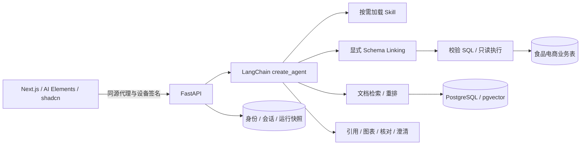

# 小马助手 · 企业运营知识助手

在一个对话中查询食品电商业务制度和订单数据，展示原文引用、实际 SQL 结果，并解释口径冲突、缺失和小样本。

评审入口：[关键设计决策](DECISIONS.md) · [需求对照](docs/requirements.md) · [架构](docs/architecture.md) · [测试与验收](docs/testing.md) · [验证记录](docs/validation.md)

## 能力

| 能力 | 实现 |
| --- | --- |
| 文档问答 | PDF 经 MinerU 解析，Markdown 经语法块解析；结构分块转为 LangChain `Document`，通过 `PGVectorStore` 入库，向量召回后可重排 |
| 精确引用 | 保留文档、版本、章节/条款、页码/行号和坐标；答案角标可打开原文并高亮 |
| Text2SQL | 精简目录 → 候选表结构 → 显式 `link_schema` → Agent 生成 SQL → 语法树校验 → 独立只读连接实际执行 |
| 自动选工具 | LangChain `create_agent` 按问题选择 RAG、SQL 或组合查询；前端开关限定本轮允许的工具 |
| 结果展示 | 实际查询结果驱动表格、图表和指标卡；核对与澄清工具的结构化参数映射到 React 组件 |
| 流式过程 | SSE 推送文本、真实工具状态、引用和原生 TodoList；上下文总结和首条消息生成标题 |
| Skill | 标准 Skill ZIP 上传、版本管理、按需读取与 `/` 选择 |
| 访问控制 | 管理员密码登录；邀请带有效期，首次兑换绑定浏览器；聊天按认证身份隔离 |



## 本地启动

需要 Python 3.12–3.13、uv、Docker Compose、Node.js 22.18+ 和 pnpm 11。本地验证环境：Python 3.13、Node.js 26.8.1、pnpm 11.25.0。

```bash
uv sync --directory apps/api --locked
pnpm --dir apps/web install --frozen-lockfile
python3 scripts/init_local.py
```

在自动生成且被 Git 忽略的 `.env` 中填写：

```dotenv
MODEL_BASE_URL=https://your-workspace.cn-beijing.maas.aliyuncs.com/compatible-mode/v1
MODEL_API_KEY=your-model-key
MINERU_API_KEY=your-mineru-key
```

聊天、Embedding 和重排共用模型服务 URL / Key。请把 `CHAT_MODEL_IDS`、`EMBEDDING_MODEL`、`EMBEDDING_DIMENSIONS`、`RERANK_MODEL` 改成网关实际开放的模型，默认值见 [.env.example](.env.example)。百炼重排地址从网关 URL 推导；普通 OpenAI 兼容服务不一定支持该接口，可设置 `RERANK_ENABLED=false`。Markdown 入库不依赖 MinerU。

```bash
docker compose up -d --wait postgres
uv run --project apps/api python scripts/import_business.py
uv run --project apps/api python scripts/init_access.py
sh scripts/dev.sh
```

另开终端启动前端：

```bash
pnpm --dir apps/web dev
```

- 助手：<http://127.0.0.1:3002/chat>
- 管理入口：<http://127.0.0.1:3002/admin>。初始密码保存在本机 `var/admin-credentials.json`（0600），不提交。
- API 契约：<http://127.0.0.1:2025/api/docs>；健康检查：`GET /api/health`。

管理员可上传文档、管理 Skill 和创建邀请。访客首次打开邀请链接绑定当前浏览器，无需单独设置密码；会话默认 24 小时，邀请有效期与设备绑定相互独立。详见 [访问控制](docs/agent-and-access.md)。

前端通过 Next.js 同源代理访问 API，模型密钥只保存在服务端。可选配置见 [前端环境模板](apps/web/.env.example)。PDF.js 资源在启动/构建前从锁定依赖生成，不提交构建产物。

## 演示资料与问题

所有客户、订单和制度均为虚构演示资料。[业务数据](data/business/README.md) 含 10 张关联表、5,000 条订单、15,027 条订单明细、474 条退款申请和 477 条退款明细。导入器校验行数与约束，建立独立 SELECT-only 账号；同一数据重复导入不追加。

通过知识库多选上传 [演示文档](data/examples/README.md)。最小核对语料为 `refund-policy-v1.pdf`、`refund-policy-v2.pdf`、`metric-definitions.pdf`、`monthly-report.pdf`。对应 Markdown 可作替代，不要同时上传同一文档的两种格式造成重复召回。预期答案仅用于验收，不进入知识库。

| 场景 | 可尝试的问题 |
| --- | --- |
| RAG / 版本 | 电子钱包退款，新旧制度分别要求多久？按什么时间选择版本？ |
| SQL | 查询全部订单总数，不限制日期，并按订单状态画柱状图。 |
| HYBRID / 缺失 | 订单110有申请和到账时间，能否判断退款是否超时？ |
| 歧义 | 请计算2026年9月的售后异常率。 |
| 冲突 | 2026年9月华东生鲜的订单退款率是多少？月报写的数值是否一致？ |

完整条件见 [验收用例](tests/acceptance/cases.json)。用例不代表全部已通过真实模型回归，当前证据见 [验证记录](docs/validation.md)。

## 检查与调试

```bash
make check-backend
make check-web
python3 scripts/check_repository.py
```

后端集成测试需要上述 PostgreSQL 和导入的业务表，使用随机独立测试 Schema，不清空应用数据。可控模型/HTTP 测试验证代码契约，不能代替生成效果评测。[CI](.github/workflows/ci.yml) 在独立数据库中执行同样检查；远端 CI 尚未运行。

通过 [调试 CLI](docs/debug-cli.md) 经正式认证接口发送消息，查看提示词快照、工具与结果：

```bash
sh scripts/xiaoma.sh login
sh scripts/xiaoma.sh chat "查询全部订单总数，不限制日期。"
sh scripts/xiaoma.sh inspect RUN_ID
```

本地运行产物保存在被忽略的 `var/`。LangSmith 默认关闭，远端 Trace 尚未验证。

## 代码与文档导航

- [Agent 最终组装](apps/api/src/xiaoma/agent/builder.py)：提示词、模型、工具、中间件。
- [运行参数与容错](docs/agent-runtime.md)：Model Profile、压缩预算、调用限额和重试。
- [Agent 与访问控制](docs/agent-and-access.md)：工具、Skill、邀请和隔离。
- [文档入库](docs/ingestion.md)：结构完整性、来源坐标、任务租约和索引发布。
- [部署说明](docs/deployment.md)：HTTPS、持久化和同源代理。
- [第三方声明](THIRD_PARTY_NOTICES.md)：AI Elements / shadcn 来源与许可。

`apps/api` 为后端，`apps/web` 为正式前端，`skills` 为内置 SOP，`data` 为合成资料，`tests/acceptance` 为人工/真实模型验收用例。`docs/_planning/` 为被 Git 忽略的本地过程资料。

尚未部署公网；未实现 Small-to-Big、混合检索、通用远程 MCP 和企业多租户平台。路由与口径判断仍有模型误判风险，取舍见 [DECISIONS.md](DECISIONS.md)。
