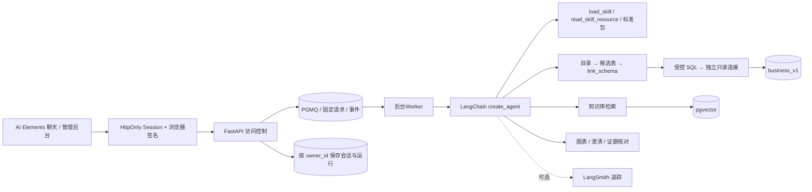

# Agent、工具与邀请访问

## 运行方式

Agent 使用 LangChain `create_agent`，由 FastAPI 的 `POST /api/v1/agent/runs` 接收后台任务，`GET /api/v1/agent/runs/{id}/events?after=N` 提供可补读 SSE。原 `POST /api/v1/agent/serve` 为提交并订阅的兼容入口。LangGraph 是 LangChain 内部的循环运行时；会话与运行快照由本项目 PostgreSQL 保存。统一从 `scripts/dev.sh` 启动，以便认证覆盖全部业务入口。当前不会额外暴露原生 `/threads`、`/runs` 或未认证的图执行接口。

## 工具与 Skill

| 工具 | 作用 |
| --- | --- |
| `load_skill` | 按需读取本轮已启用的 SKILL.md 正文、资源目录与版本 |
| `read_skill_resource` | 读取已加载技能当前运行版本的文本资源 |
| `search_knowledge` | 检索真实分块，返回文档/版本/条款/页码和引用链接 |
| `list_tables` | 仅表名与简短业务说明 |
| `get_table_schema` | 每次读取 1–3 张候选表的字段及关系 |
| `link_schema` | 显式选表、字段、关联与粒度，生成本轮上下文 ID |
| `execute_readonly_sql` | Agent 直接生成 SQL 后实际执行；检查上下文及 SQL 语法树 |
| `render_chart` | 依据已执行结果生成表格、指标、柱状图或折线图；参数不接受自造 rows |
| `present_evidence_review` | 引用本轮文档和 SQL 证据，输出冲突、缺失、小样本或执行偏差 |
| `ask_clarification` | 展示用户可选择的澄清项，不替用户作选择 |
| `write_todos` | LangChain TodoListMiddleware 的真实任务状态 |

前端的知识库/业务查询开关是本轮工具选择，不是提示词建议。后端根据布尔开关注册工具，并过滤依赖这些工具的 Skill；工具内部再次验证当前会话有效性。关闭业务查询会移除目录、Schema、链接和执行工具，不能通过 Skill 重新启用。

内置技能位于 `skills/` 的标准 Skill 目录，包含 SKILL.md 和可选参考资料。管理员可上传标准 ZIP、查看文件、下载、上传新版本和启停；访客可用 `/` 显式选择本轮技能，也可由模型按需加载。Skill 文件和资源按 revision 保存于私有数据库，运行时固定修订，更新只影响后续运行。ZIP 脚本不自动执行，技能不能注册未授权工具。详见 [运行预算与标准 Skill](agent-runtime.md)。

当前先使用本地类型化工具。需要外部复用时，可以给已存在的服务增加 MCP 适配层；没有开放用户提交任意 MCP 地址或执行脚本的入口。

管理员可删除上传技能，并从“最近删除”恢复此前启用状态；内置技能由服务端按原始来源保护，禁止删除。删除只影响后续运行，已启动运行仍使用固定的历史资源版本。

技能页面位于助手主导航“Agent 配置”（`/agents`）的“技能”标签中，仅管理员可管理。邀请后台独立通过 `/admin` 地址访问，不在助手侧边栏提供入口；该地址仍受原有认证、管理员权限与设备签名保护。Agent 配置预留按标签扩展远程 MCP 等能力的结构，当前只提供技能功能。

## SQL 边界

模型通过精简目录逐步发现业务结构，不将全量 DDL 预先装入模型上下文。只有先查看过的表字段才能被 link_schema 选中。上下文 ID 仅存在于本轮运行，不能借用其他访客、会话或旧运行的 ID。

执行前用 SQLGlot 校验单条 SELECT、CTE/别名及已选字段，拒绝写入、SELECT INTO、锁、外部表函数、系统 Schema、未链接表字段和任意函数调用。COUNT(*) 允许，普通 SELECT * 被拒绝。执行使用独立 SELECT-only 账号、只读事务、5 秒数据库超时和外层 201 行读取上限，展示最多 200 行；过大结果另外标记截断。执行失败会返回可恢复的工具错误，不伪造执行成功。

查询结果与证据由服务产生 ID 并保存在所属回答中。模型仅选图表字段和展示意图，数值取实际结果。每条回答默认保留一份主结果视图，辅助 SQL 留在工具记录中。页面先展示结果卡片，流式解释追加在下方；同一展示 ID 从加载到完成均保留首次出现的位置，实时更新与历史回放使用相同布局。证据工具校验本轮结果与文档的归属，Agent 按 SOP 核对口径可比性并给出核对分类。

## 聊天引用

知识库检索按本轮证据加入顺序分配引用编号，SSE 与历史消息保留累计来源目录。前端只用所属回答的目录解析 `[1]`、`[1][3]` 及完整原文链接；Markdown AST 转换保留表格结构，跳过代码、公式和已有链接，没有对应来源的编号保持普通文字。来源目录作为显式插件参数参与渲染缓存，避免同号引用串到其他回答。

角标悬停或聚焦时加载片段并直接渲染 Markdown；点击在当前聊天内打开原文弹窗、定位并高亮对应区域。关闭后保留聊天与滚动位置，焦点回到角标时不重开悬浮卡；再次悬停或键盘重新选中才显示预览。引用预览不伪造检索分数；加载失败、片段更新或移除会提示不可用，不替换成其他片段。

## 模型与参数

模型 URL 和 Key 使用 `MODEL_BASE_URL` / `MODEL_API_KEY`，前端只提交模型 ID。可用性读网关 `/models` 并与 `CHAT_MODEL_IDS` 取交集。

能力信息优先读取 LangChain `model.profile`。对当前大陆百炼网关，缺失的 Profile 可以从公开 models.dev 的 `alibaba-cn` 精确模型记录补齐，再传给 LangChain。不会从其他供应商的同名模型猜上限；公共资料不可达时保留未知字段，聊天仍可运行。公共能力声明与网关实际配额不同；主回答默认跟随 Profile 输出上限，并依据系统提示、消息和工具 Schema 占用动态预留空间。公开参数请求不携带模型 Key。

一次运行固定模型；用户在下一次发送前可以切换。每轮限制递归步数及总运行时间，每个身份每分钟最多启动 20 次，默认每身份同时执行两个回答、最多十个待完成任务，其余排队；同一会话串行，不同会话可同时运行。会话记在 PostgreSQL，使用原生 SummarizationMiddleware 总结较早消息，摘要和近期消息单独保存；完整页面历史保留，不删除原记录。

参考：[LangChain Models / Profiles](https://docs.langchain.com/oss/python/langchain/models)、[Skills pattern](https://docs.langchain.com/oss/python/langchain/multi-agent/skills)、[Middleware](https://docs.langchain.com/oss/python/langchain/middleware/built-in)、[models.dev](https://models.dev)。

## 邀请与设备绑定

- 管理员以本地生成的独立密码登录，原始密码不写入仓库；环境变量保存 scrypt 哈希。
- 邀请使用随机 256 位令牌，数据库仅存 SHA-256 哈希，完整链接仅在生成或重置时返回。
- 邀请链接把令牌放在 URL fragment；浏览器兑换成功后移除 fragment，令牌不会作为 URL query 发给服务或进入常规访问日志。
- 首次兑换时绑定浏览器 P-256 公钥和独立访客 UUID。私钥以不可导出的 CryptoKey 保存到 IndexedDB。
- 会话使用 HttpOnly / SameSite=Strict Cookie。每个业务请求还需用浏览器私钥签名方法、路径/查询、时间戳、单次 nonce 和请求体摘要；复制 Cookie 或只伪造设备 ID 不能通过验证。
- 验证挑战和请求 nonce 单次使用且过期，登录/兑换有频率限制。过期挑战、nonce、限流记录和会话定期清理。
- `valid_from <= now < expires_at` 才能兑换或继续访问。每次请求、每次工具调用及流式运行期间都会重新核验；撤销或到期会阻止后续请求并停止该身份的后台执行及后续输出。
- 管理员可调整有效期、撤销、重置设备。换绑轮换邀请令牌并撤销旧登录，新设备建立新访客身份，不继承旧访客聊天。

这里绑定的是浏览器环境，不是硬件身份认证。清理浏览器数据、换浏览器或换设备需要管理员重置；未使用的邀请由首次持有并兑换的人绑定。不能阻止已授权访客复制其已看到的内容。

## 数据隔离与权限

知识库和食品电商库为演示共享资料：管理员维护，受邀访客只读查询。聊天的创建、读取、删除、恢复、追加消息和运行快照均按服务器认证得到的 `owner_id` 检查归属。前端传 conversation_id 不产生读取权限，管理员也没有通过页面读取其他访客历史的特殊入口。

会话消息、工具过程、SQL 结果及卡片持久化在同一归属下，重启后可以恢复。浏览器更换登录身份时会重建前端仓库状态，不保留上一身份的会话缓存。业务 SQL 账号也没有应用会话 Schema 的权限。

## 上线配置

已完成本地运行及公网 HTTPS 功能验收，复现步骤见 [部署说明](deployment.md)。部署时需使用 HTTPS，将 `WEB_ORIGIN` 设为实际前端域名并设置 `AUTH_COOKIE_SECURE=true`。Next.js 与 API 使用同源代理；数据库与 API 端口保留内网/回环访问，不直接暴露旧调试服务。Python 服务必须从 `scripts/dev.sh` 指定的 FastAPI 入口启动；生产进程管理可改用同一 `xiaoma.app:app`，不要另起未经此认证边界保护的图服务。

反向代理应关闭 SSE 缓冲、允许长连接、限制请求体并配置基础请求限流。原文件和 MinerU ZIP 位于 var，不放到公开静态目录。API 文档可查看接口契约；执行业务请求仍需签名，普通 curl Cookie 不能代替设备证明。

LangSmith 通过环境变量启用，Agent 与工具运行成链，并附带应用运行及会话元数据。默认关闭数据上传。

## 流式、会话压缩与标题

SSE 使用 `Cache-Control: no-store, no-transform` 和 `X-Accel-Buffering: no`。认证中间件保留这些头，避免 Next.js gzip 将小事件攒到结束后再发送。没有模拟打字延迟。

使用原生 `TodoListMiddleware` 和 `write_todos`。SQL、多项统计和跨来源任务按 3–5 个业务阶段规划；前端直接显示工具产生的任务状态。未完成、失败或停止时，不标记全部完成；可恢复的工具异常也立即显示为失败，修正后继续执行。

使用原生 `SummarizationMiddleware`，默认在模型窗口约 75% 时总结，保留约 25% 的近期原文，较早信息整理成私有摘要。未知 Profile 时使用 128k 应用回退预算；网关实际窗口较小时可覆盖。消息按保守近似计数，完整页面聊天不删除；总结器有独立输出预算与空摘要/截断保护。`chat_contexts` 按 owner_id 保存压缩上下文，`chat_messages` 保存完整记录。

原生 ModelCallLimitMiddleware 和 ToolCallLimitMiddleware 每轮分别限制 64 次主模型调用和 128 次工具调用；图步骤 512，总超时 900 秒。限制的是一次回答，不是聊天总轮数。重试属于逻辑调用内的尝试；标题与摘要不计入主模型调用次数，仍受超时约束。最终组装集中在 `apps/api/src/xiaoma/agent/builder.py`。

新对话根据首条消息运行独立 LangChain 标题链 `generate_conversation_title`，实时更新侧边栏，后续追问不改名。标题预算 512 token，超时 8 秒；兼顾推理模型的内部 token 开销，失败保留初始标题，不影响回答。

配置入口为根目录 `.env`，完整字段与默认值见 `apps/api/src/xiaoma/settings.py` 和 `.env.example`。修改后重启 API。模型和密钥继续复用一套 URL / Key；`CHAT_TEMPERATURE` 默认不传，遵循模型服务默认；没有强行覆盖不同模型的推理开关或 top_p。

## 后台运行

聊天与解析分别使用 PGMQ；关闭页面、刷新和切换会话不会取消任务。事件按运行序号持久化，前端恢复快照后补读缺失片段。显式停止跨进程撤销执行权；聊天进程异常不自动重放整个回答。部署、并发及恢复边界见 [后台任务](background-jobs.md)。

## 故障恢复与运行状态

`agent/resilience.py` 组合 LangChain 原生 `ModelRetryMiddleware`、`ToolRetryMiddleware`，增加选择性重试和流式保护。每次最多额外重试 2 次，1 秒起步、指数退避、±25% 抖动、单次等待上限 4 秒；仍受 900 秒总超时约束。只处理临时连接、超时、408/429/5xx、数据库连接失效或瞬时事务故障。鉴权、参数、SQL 语法、Schema Linking 错误不重复执行，由受控错误消息让模型修正。只对检索和只读查询工具自动重试，展示类工具不重放。同工具同参数连续失败三次停止循环，保留已有结果。

聊天 SDK 重试为 0，检索用 Embedding 的 SDK 重试也为 0，避免和工具中间件相乘；独立文档入库仍保留原有 Embedding SDK 两次重试。摘要使用自定义 summarizer 包装相同的有界瞬时故障重试，绕过原生摘要器的额外默认重试；失败不会把空摘要写入历史。标题链最多 3 次尝试且总共不超过 8 秒，失败保留原标题。

如果当前模型调用已经吐出正文、模型返回的思考内容或工具参数片段，自动模型重试停止，保留部分输出并报错，避免重复拼接。工具重试耗尽后向模型返回脱敏错误，不能把失败包装成查询成功；权限错误仍立即终止。停止、超时和异常会释放运行租约，保存部分回答，并把未完成工具标为失败。

前端把模型返回的思考内容与工具调用合为一个“处理过程”，顶部只显示当前阶段。新记录按真实开始时间交错排列；缺少工具时间戳的旧记录保留原有分组，不补造时序。模型未返回思考内容时，不生成模拟思考文本。完整参数与技能修订在每次运行快照中保存。

展开策略：

- 运行中自动展示当前思考及工具步骤；每段思考结束即自动收起正文，包括运行中曾手动展开的情况，结束后可再次点击查看。工具参数默认收起；开始输出正文或成功结束后，自动收起整个处理过程。
- 运行失败自动展示详情及失败工具；用户主动停止后收起，保留部分输出供查看。历史成功记录默认收起。
- 运行中手动展开或收起不被后续 Token 和工具阶段覆盖；成功结束或主动停止时统一收起，失败时展示详情。结束后仍可手动展开；运行中和结束后的选择分别保存，在当前登录工作区内切换页面或会话仍保留。
- 自动模式跟随最新步骤；手动查看详情或向上滚动阅读时停止追随。思考正文限制高度，长内容在区域内滚动。
- 普通聊天没有实际思考或工具记录时只显示等待行，正文开始后隐藏，不出现空折叠入口。底部任务条继续独立显示原生 write_todos 状态，默认折叠。

参考：[LangChain 官方中间件](https://docs.langchain.com/oss/python/langchain/middleware/built-in)、[官方 Deep Agents 总结实现](https://github.com/langchain-ai/deepagents/blob/main/libs/deepagents/deepagents/middleware/summarization.py)。参考其预算与上下文管理思路，项目继续使用 LangChain `create_agent`。
