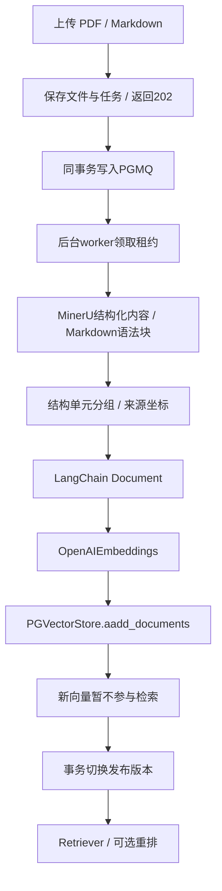
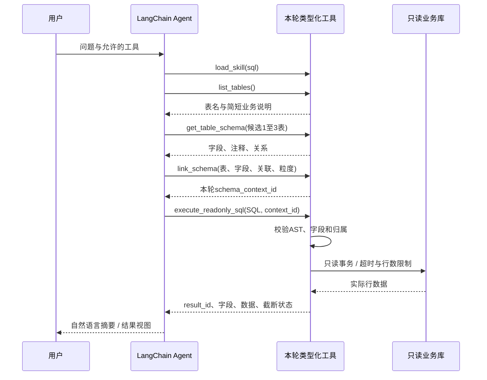

# 架构与数据流

## 模块职责

| 位置 | 职责 |
| --- | --- |
| `apps/web/src/features/chat` | AI Elements 聊天、SSE、引用、结果组件 |
| `apps/web/src/features/knowledge` | 上传、检索测试、连续 PDF 与高亮 |
| `apps/api/src/xiaoma/app.py` | 生命周期、认证边界、入库/检索/数据浏览 |
| `apps/api/src/xiaoma/agent/builder.py` | Agent 最终组装：系统提示、模型、工具、中间件 |
| `apps/api/src/xiaoma/agent/service.py` | LangChain 执行、流、提示词/结果快照和持久化 |
| `apps/api/src/xiaoma/agent/background.py` | PGMQ 调度、执行租约、停止与可补读事件 |
| `apps/api/src/xiaoma/task_queue.py` | 聊天/解析两条 PGMQ 队列的事务操作 |
| `apps/api/src/xiaoma/agent/sql.py` | 显式 Schema Linking、AST 限制与只读执行 |
| `apps/api/src/xiaoma/ingestion` | 解析、结构分块、LangChain 入库 |
| `skills` | 文档、查询、核对和图表 SOP |

## 文档入库

应用状态、任务和规范分块由 SQLAlchemy 管理，向量通过 LangChain 写入。全部写入成功才发布，失败保留旧索引。完整单元允许超长，不机械裁断表格与说明。坐标来自解析产物，不由前端猜测。见 [入库设计](ingestion.md)。

## 自动工具选择与 SQL

SQL 由主 Agent 直接生成，不另设生成 SQL 的子 Agent。全量 DDL 不进入初始提示词，字段须先查看和显式链接。工具校验与数据库账号共同限制只读访问，业务查询账号不能访问应用会话表。

RAG、SQL、HYBRID 表示实际使用工具的路径，不是三个固定节点。模型可以继续检索、修正可恢复错误或请求澄清。调用限额、超时和选择性重试约束循环。见 [设计决策](../DECISIONS.md)。

## 流与展示契约

提交请求返回 202 与 run_id，PGMQ 后台 Worker 执行。文本、工具、任务、引用与结果卡先保存事件及消息快照，再通过带序号的 SSE 发送。切页/断线只影响订阅，刷新后按游标补读并去重；显式停止会撤销执行令牌。详见 [后台任务](background-jobs.md)。前端不模拟打字。`write_todos` 来自 LangChain 原生中间件。UI 展示可观察工具过程与简短状态，不将其当作模型内部推理的证明。

图表只接受已执行结果 ID 与字段映射；核对引用本轮文档/结果；澄清返回选项。Pydantic 工具参数形成 JSON Schema，前端按类型注册 React 组件。对应实现见 [tools.py](../apps/api/src/xiaoma/agent/tools.py)、[presentation-types.ts](../apps/web/src/features/chat/presentation-types.ts) 与 [chat-presentations.tsx](../apps/web/src/features/chat/chat-presentations.tsx)。

## 状态与权限

PostgreSQL 保存知识索引、身份/邀请、会话/运行；私有文件目录保存原文件和解析 ZIP。Skill 按修订保存，上下文总结与完整历史分别持久化。模型连接保存在服务端，前端只选允许的模型 ID。

邀请兑换绑定浏览器公钥与访客 UUID，业务请求检查 Cookie、签名与有效期。管理员维护共享知识库和业务数据，聊天按服务器认证的 `owner_id` 隔离。邀请后台通过独立 `/admin` 访问。见 [访问控制](agent-and-access.md)。

服务入口是 FastAPI，后台消费可内嵌或通过独立 Worker 进程运行，内部使用 LangGraph 运行 LangChain Agent，不是独立 LangGraph Platform 部署。LangSmith 为可选服务，默认关闭。

## 项目介绍中的 Text2SQL 演示

`/project` 的 Text2SQL 页用工具矩阵与分步上下文展示目录发现、分批查看 Schema、显式 Linking、只读执行和 ChatBI。示例快照通过生产 `SqlSession` 和独立只读账号生成，保留实测 SQL 与合成数据结果；页面切换节点不会重新执行查询或调用模型。

数据包变更后，可运行 `PYTHONPATH=apps/api/src uv run --project apps/api python scripts/build_sql_demo.py` 刷新快照。此命令需要已导入业务数据的本地环境，不纳入无数据库的静态检查。

## 项目介绍中的证据核对

`/project` 的“证据核对”展示月报冲突、版本适用、缺失验收时间、小样本与指标澄清，并保留零分母样例。文档弹窗渲染仓库合成资料节选，SQL 弹窗展示独立只读查询的实测快照；可以查看字段与统计粒度。核对卡与澄清组件复用聊天渲染器，示例交互不调用模型、不发送聊天。

`scripts/build_review_demo.py` 从正式 `SqlSession` 生成并核验五份只读查询快照。需要刷新时运行 `PYTHONPATH=apps/api/src uv run --project apps/api python scripts/build_review_demo.py`，需要已导入业务库。
