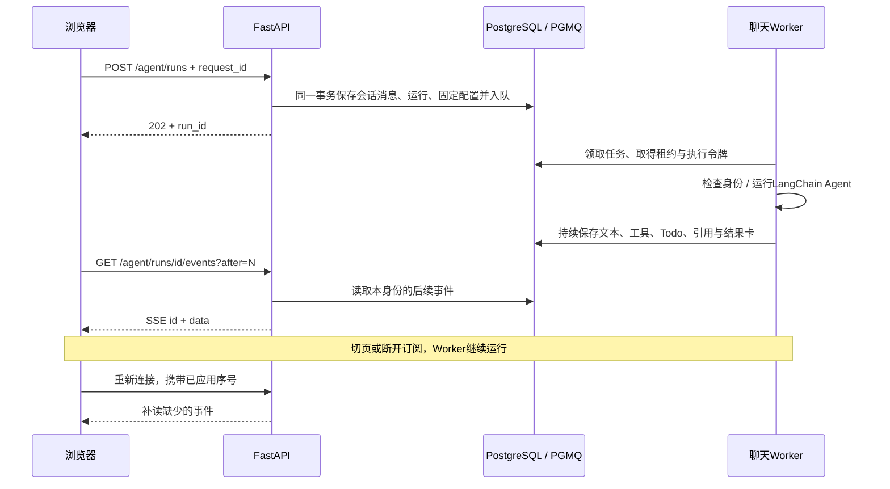

# 后台任务与可恢复输出

聊天与文档解析使用两个独立 PGMQ 队列。队列只保存任务 ID，请求、状态、历史、结果和事件保存在应用表中。浏览器订阅与执行生命周期分离：关闭页面、切换会话或 SSE 断开不会取消任务。

## 安装与启动

```bash
docker compose up -d --wait postgres
uv run --project apps/api python scripts/init_queue.py
sh scripts/dev.sh
```

使用官方 PGMQ v1.13.0 的 SQL-only 分发，不替换现有 PostgreSQL 17 / pgvector，不清空数据卷。固定上游源、版本、SHA-256 和许可保存在 [third_party/pgmq](../third_party/pgmq/manifest.json)。初始化器校验哈希，在事务中安装；已有安装不会被静默覆盖。业务只读账号不授予 PGMQ 权限。

本地默认由 API 的生命周期启动独立后台协程池。部署可拆成两个进程：API 配置 `BACKGROUND_WORKERS_ENABLED=false`，Worker 运行：

```bash
sh scripts/worker.sh
```

Worker 使用同一 `.env`、数据库与文档存储目录，并显式启用消费。不要求浏览器保持连接。多个进程共享队列；跨主机部署还需要共享原文件存储，当前未实现对象存储适配。

## 聊天执行



请求的模型 ID、工具开关、Skill 正文/修订和历史在入队时固定。Worker 读取同一修订的资源，后台更新 Skill 不改变已排队任务。执行前与运行中检查会话/邀请有效性；订阅和停止接口均检查 owner，不以 UUID 难猜代替权限。

| 接口 | 行为 |
| --- | --- |
| `POST /api/v1/agent/runs` | 提交并返回202；`request_id` 可用于同身份幂等重试 |
| `GET /api/v1/agent/runs/{id}` | 本身份的运行状态及当前消息快照 |
| `GET /api/v1/agent/runs/{id}/events?after=N` | 从已应用序号后补读，再跟随实时事件 |
| `POST /api/v1/agent/runs/{id}/stop` | 显式停止，撤销执行权并保存部分结果 |
| `POST /api/v1/agent/serve` | CLI兼容入口；同样提交后台任务再订阅，断线不取消 |

事件先写入数据库再发送，序号在运行行锁下递增。消息快照同时记录 `eventSeq`；前端跳过已经应用的事件，较旧列表响应不能覆盖较新的实时消息。文本按上游流片段保存，工具参数/状态、任务、引用和结果卡也可补读。SSE 结束本身不等于任务成功，终态以服务端记录为准。

同一会话最多一个排队/运行中的回答，重复发送返回409；不同会话可并发。默认每身份2个执行中、最多10个待完成，聊天池4个槽位，解析池2个槽位。超过执行并发的任务继续排队。参数见 [.env.example](../.env.example)。

## 租约、停止与重启

PGMQ 可见性超时配合应用租约与 `lease_token`。领取先提交队列预约，再锁应用行，避免取消/续租与领取形成相反锁顺序。事件、消息、标题、摘要发布前都检查令牌与租约，旧 Worker 不能覆盖已停止或被接管的运行。

点击停止后立即撤销执行令牌、归档队列消息并记录终态，保留已保存的内容。Worker 下一次检查时取消本地执行；已经发出的外部请求能否立即中断取决于服务方。停止后的片段不再发布。CLI 可执行 `sh scripts/xiaoma.sh stop RUN_ID`，Ctrl+C 也尝试提交停止请求；网络异常时不要假定后台已取消。

- **仍在排队的任务**：进程重启后可以继续领取，已做重启恢复测试。
- **执行中进程正常退出**：保留部分结果并标明中断。
- **执行中进程突然消失**：租约到期后标记 interrupted，保留部分结果，请用户重新发送；不会自动重放整个回答。如果最终结果已经提交、仅队列确认未完成，则保留其已完成终态并补做确认。
- **文档解析**：沿用过期接管及独立 `index_id`，旧尝试不能发布新索引。完成/失败后确认队列消息，重处理失败保留旧索引。

队列投递不等于业务代码严格只执行一次。本版也没有实现 Agent 从任意模型/工具中间步骤无缝续跑；这需要额外的图检查点与工具状态恢复设计。

## 持久化与验证

`chat_run_jobs` 保存固定请求、身份、Skill、历史、排队状态与租约；`chat_run_events` 保存可重放事件；原有 `chat_runs` / `chat_messages` / `chat_contexts` 保存运行快照、页面历史和压缩上下文。队列按知识 Schema 隔离，集成测试使用独立队列并清理，不影响正式任务。

自动化覆盖无订阅多会话并发、并发额度与排队、显式停止、幂等重试、同会话串行、跨身份拒绝、邀请撤销、租约失效防止旧写入、真实 TCP 断开与游标补读、排队任务跨应用重启、分配与入队事务回滚。前端另测重复回放去重、工具/引用恢复、状态隔离和旧快照竞争。

尚未提供运行事件/队列归档的自动保留期清理，也未完成生产压力测试。验证记录见 [validation.md](validation.md)。
